  

I build AI agent systems end to end: models, tools, memory, orchestration, interfaces, and deployment. These projects are now open source.

**My previous GitHub account: [@worldofaryavart](https://github.com/worldofaryavart)** — explore my earlier projects and contributions there.

## Open-source projects

| Project | What I’m building | Links |
| --- | --- | --- |
| **NanoCrew** | A self-hosted crew of AI agents with Docker sandboxes, memory, schedules, handoffs, and human approvals. | [GitHub](https://github.com/shivasaini04/nanocrew) · [Quickstart](https://github.com/shivasaini04/nanocrew#quickstart-docker) |
| **Memeostan** | A virtual nation with citizenship, governance, courts, and an AI civil service. | [GitHub](https://github.com/shivasaini04/memeostan-open) · [Live](https://memeostan.xyz) |
| **Sindara Studio** | Code-drawn video starters, shared timelines, procedural audio, and an agent-guided production toolkit. The studio also makes stories, explainers, brand concepts, and animated series. | [GitHub](https://github.com/shivasaini04/sindara-open) · [Studio](https://sindara.axoncrew.com) |
| **Memeostan Voice** | An experimental Exotel voice-agent starter for Hindi and Hinglish, with a browser demo and operator dashboard. | [GitHub](https://github.com/shivasaini04/memeostan-voice) · [App](https://voice.memeostan.xyz) |

## Find me

[AxonCrew](https://axoncrew.com) · [LinkedIn](https://www.linkedin.com/in/shiva-saini-066157253) · [hello@axoncrew.com](mailto:hello@axoncrew.com)
