  

## Hi, I'm Shiva 👋

I'm an AI engineer from India. I build the whole stack of an AI agent system: the models, the tools, the memory, the orchestration, and the backend, frontend and deployment around them. I run [AxonCrew](https://axoncrew.com), an AI agents and automation studio, and I'm moving my personal projects into the open here.

## What I do

| | |
|---|---|
| 🤖 **Autonomous agents** | Multi-agent crews that share a workspace, hand work to each other, run on a schedule and ask a human before anything risky. |
| 🧱 **Full-stack products** | React and Next.js dashboards on TypeScript or Python backends, shipped to real servers with Docker, Caddy and systemd. |
| 🔐 **Systems with rules** | Signed actions, server-authoritative state, append-only ledgers: software where the logic has to hold up. |

## Open source

### [🌐 United Memeostan](https://github.com/shivasaini04/Memeostan)
A satirical virtual nation where citizens are real people and the government is AI. The Cyber Police, courts and election commission run on LLMs, and laws that pass a vote bind them with no deploy. Under the jokes it is a signed-action state machine with a hash-chained currency ledger.
`Next.js` · `TypeScript` · `MongoDB` · [**live → memeostan.xyz**](https://memeostan.xyz)

### NanoCrew &nbsp;(open-source release coming)
A platform for running a crew of AI agents. Each agent has its own identity, memory, tools and schedule, works inside a Docker sandbox, and hands tasks to the others. You manage the crew from a web dashboard, with approvals for sensitive actions and any model behind a LiteLLM gateway.
`TypeScript` · `Python` · `Docker` · [**product → crew.axoncrew.com**](https://crew.axoncrew.com)

### Next up
`Navarya` · `Horoscope` · `Waterfall` — going public soon, more after that.

## Tech I work with

## Find me

[🌍 axoncrew.com](https://axoncrew.com) · [💼 LinkedIn](https://www.linkedin.com/in/shiva-saini-066157253)
